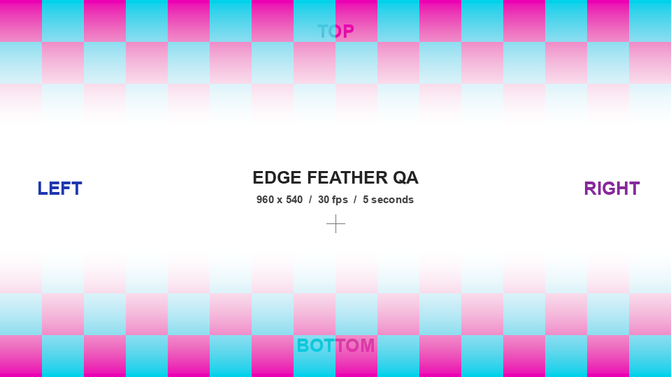

# Side Feather

**Independent edge fades for Adobe Premiere Pro.**

Blend stacked video clips without drawing opacity masks. Feather the left, top, right and bottom edges separately, extend a fade across the full image, or link sides when you want matching amounts.

[Download the Mac beta](https://github.com/mathewharwich/side-feather/releases/tag/v0.1.0-beta.1) · [Project page](https://dev.mathewharwich.com/side-feather) · [Privacy](PRIVACY.md) · [Support](SUPPORT.md)



## Install

1. Download `SideFeather-0.1.0-beta.1-macOS.dmg` from [Releases](https://github.com/mathewharwich/side-feather/releases/tag/v0.1.0-beta.1).
2. Open the disk image, then open **Install Side Feather** and choose **Install**. No administrator password is needed.
3. Restart Premiere. Find **Video Effects → Harwich → Side Feather** and drag it onto a clip.

**This beta is Developer ID signed but has not been notarized by Apple.** macOS may block the first launch. If you trust the release, try opening the installer, then use **System Settings → Privacy & Security → Open Anyway** for that app. See [Apple's instructions for opening trusted unnotarized software](https://support.apple.com/en-us/102445). Signing does not mean Apple has reviewed this beta.

The release includes `SHA256SUMS.txt` so you can verify the downloaded DMG or ZIP with `shasum -a 256 -c SHA256SUMS.txt` when both downloads are in the same folder.

The installer places the effect in your account's Adobe MediaCore plug-in folder. It preserves an older Side Feather installation in your local Side Feather Backups folder before replacing it. To remove the plug-in, run the same installer and choose **Remove**. Existing Premiere projects need the plug-in installed to render its effect.

A ZIP is also available for manual installation. Copy `Side Feather.plugin` into:

```text
~/Library/Application Support/Adobe/Common/Plug-ins/7.0/MediaCore/
```

The source checkout also provides `bash scripts/install.sh` and `bash scripts/uninstall.sh` for locally built copies.

## Use it

For a bottom-only fade, leave **Link Sides → Independent**, raise **Bottom Feather**, and leave the other sides at zero. For a middle band, adjust Top and Bottom separately or select **Top + Bottom** and use **Linked Feather**. Leave enough overlapping picture beneath a fade so it can reveal the other clip.

| Control | Behavior |
| --- | --- |
| Left / Top / Right / Bottom Feather | Independently fade that side into transparency. Zero leaves it untouched; 100% spreads the fade across the full image dimension. |
| Link Sides | Independent, Top + Bottom, Left + Right, or All Sides. Linked sides use Linked Feather; the other sides keep their own amounts. |
| Linked Feather | Shared percentage for the chosen linked sides. Independent values are retained when you switch modes. |
| Fade Curve | Smooth for a gentle blend, or Linear for a constant ramp. |
| Edge Insets | Move each fade boundary inward before feathering, useful for a band inside a larger source image. Opposing insets that meet or cross make the image transparent. |

Amounts follow the image dimensions when the clip is scaled. Side Feather reduces existing alpha; it does not blur picture detail. Its result depends on the image entering its position in the effects stack. If another effect has already cut a hard edge inside that image, match the corresponding inset, adjust the effect order, or use a nest with suitable bounds.

## Compatibility and performance

This is the first public beta. The Mac download contains Intel and Apple silicon code and targets macOS 12 or later. **Live checks were performed in Premiere Pro 26.5.2 on an Intel Mac.** Other Premiere versions, Apple silicon runtime behavior, After Effects, Windows, interlaced sources and HDR delivery have not been qualified. Premiere's own operating-system requirements also apply.

This version renders on the CPU. Several stacked 4K clips may need reduced playback resolution or rendered previews. See [verification](docs/VERIFICATION.md) for what was tested and the remaining limits.

## Build from source

On macOS, install Xcode Command Line Tools, Python 3 and stable Rust with support for the 2024 edition. No API key or separate Adobe SDK download is needed: the build uses the published Rust bindings and their generated API declarations.

```sh
git clone https://github.com/mathewharwich/side-feather.git
cd side-feather
bash scripts/check.sh
bash scripts/build.sh universal
bash scripts/install.sh
```

Contributor builds use ad-hoc signatures for local development. Public Developer ID signing uses the maintainer's Apple credentials; they are not included in the repository. Notarization is not completed for this initial beta. Source is under `src/`; build and installation scripts are under `scripts/`. The native effect identifier and internal executable retain the original Edge Feather development name for project compatibility.

Core and pixel-buffer tests also run on Linux. To generate local synthetic Premiere QA images and importable XML sequences, install Pillow and run `python3 tests/create_qa_assets.py`. The generated files stay under the ignored `verification/` folder.

## Open source

Side Feather is free under the [MIT license](LICENSE). Contributions are welcome; see [CONTRIBUTING.md](CONTRIBUTING.md). Third-party notices and license texts are included with the release. Side Feather is independent of Adobe.
